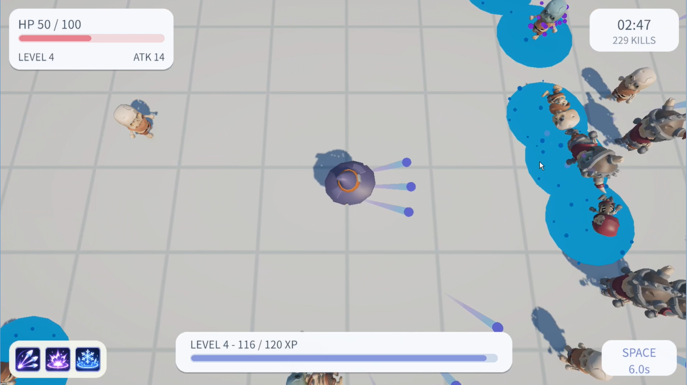
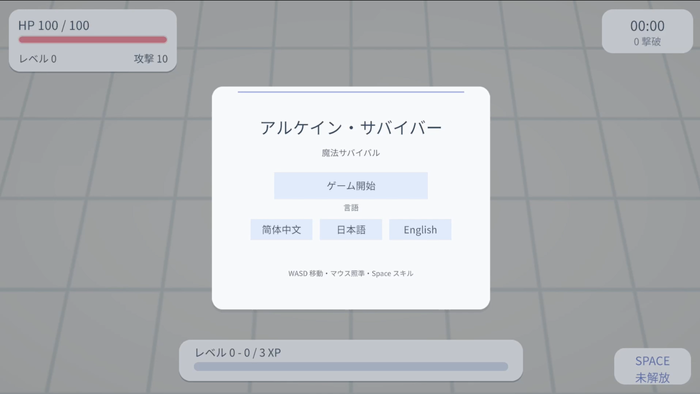
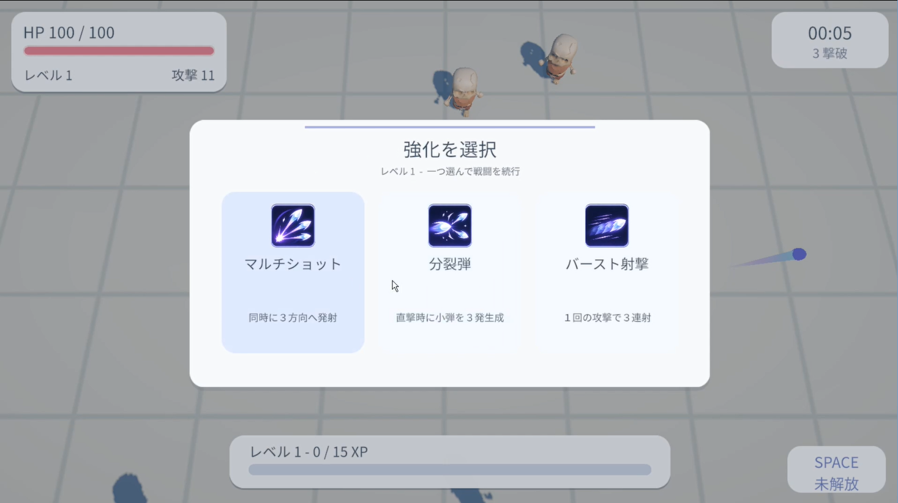
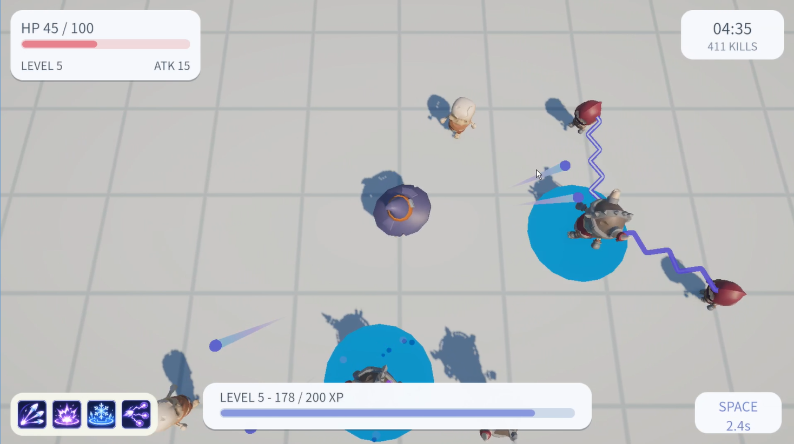
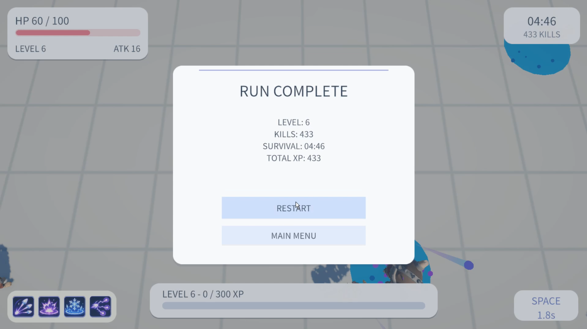

# ArcaneSurvivor

[English](README.md) | [简体中文](README.zh-CN.md) | **日本語**

**ArcaneSurvivor** は、**Unity 6・URP・C#** を使用して個人開発した、**2.5D見下ろし型アクションサバイバルゲームのデモ作品**です。移動とエイムを使い分けながら敵の群れを倒し、魔法弾や範囲効果の強化を組み合わせて戦います。

> **開発状況：** Windows向けのプレイ可能なデモが完成し、Unityエディター外での動作確認済み。  
> **開発環境：** Unity 6.3 LTS（6000.3.27f2）・Universal Render Pipeline（URP）  
> **対象環境：** Windows x86-64  
> **開発形態：** 個人開発

## ゲーム概要

- **WASD** で移動し、**マウス**で独立して狙いを定めます。通常の魔法弾は自動発射されます。
- **Normal・Fast・Tank** の3種類の敵を倒すと経験値を獲得します。
- **Lv.1、Lv.2、Lv.4、Lv.5** で、それぞれ3つの候補から強化を1つ選択します。
- **Lv.3** で円形に魔法弾を放つアクティブスキルを解放し、**Space** キーで使用します。
- **Lv.6** に到達すると勝利フローに移行し、終了または **Endless（エンドレス）モード**への継続を選べます。
- UIは**日本語・英語・中国語**に対応しています。

### 強化システム

| レベル | 強化・スキル |
| --- | --- |
| Lv.1 | マルチショット、分裂弾、連続発射 |
| Lv.2 | 弾の大型化、着弾爆発、貫通 |
| Lv.3 | 円形アクティブスキルを自動解放 |
| Lv.4 | 攻撃速度2倍、範囲凍結、範囲減速 |
| Lv.5 | 持続ダメージエリア、連鎖ダメージ、核エネルギーダメージ |

強化選択時に獲得するのは候補のうち1つです。**ヒット時効果の発動条件は魔法弾の有効な直接命中のみ**です。爆発・連鎖・持続ダメージなどの二次ダメージから、別のヒット時効果が再帰的に発動することはありません。

## 主な戦闘エフェクト

| エフェクト | 動作と表現 |
| --- | --- |
| **Impact Explosion（着弾爆発）** | 紫色のパーティクルによる爆発と追加の範囲ダメージ |
| **Area Freeze（範囲凍結）** | 水色の円盤と持続パーティクル。フィールドは0.8秒間存在し、後から入った敵も凍結します。同一フィールドによる凍結は敵1体につき1回のみ |
| **Area Slow（範囲減速）** | 紫色の円盤が一瞬表示され、命中時に範囲内の敵を減速。**持続型の減速フィールドではありません** |
| **Damage Zone（持続ダメージエリア）** | 赤い範囲リングとピンク系の地面の魔法亀裂。3秒間、一定間隔でダメージを与えます |
| **Chain Damage（連鎖ダメージ）** | 青紫色の2層の稲妻で、最大5体の追加対象にダメージ |
| **Nuclear Damage（高威力魔法弾）** | 黄緑色の高エネルギー弾、トレイル、ヒットエフェクト、専用SE。弾ダメージは5倍ですが、当たり判定の半径は拡大しません |

## 技術的な実装ポイント

- **発射ごとのデータ保持：** `AutoAttackController` が発射時点の強化状態をデータとして構築します。
- **責務を分離した戦闘処理：** `MagicProjectile`・`ProjectileSpawner`・`HitProcessor` が移動・当たり判定・生成・ヒット時効果を分担します。
- **二次ダメージの再帰防止：** 爆発・連鎖・持続ダメージが別のヒット時効果を再発動させない設計です。
- **状態異常の管理：** `EnemyStatus` が凍結・減速の時間と優先順位を管理し、エリアの描画処理と分離しています。
- **持続型の範囲効果：** `DamageArea` が周期的なダメージを処理し、VFX専用コンポーネントが円盤・亀裂・稲妻を描画します。
- **プレイ可能な一連のゲームフロー：** 多言語UI・HUD、強化選択、勝利、Endless、SEなどを実装しています。

## 操作方法

| 入力 | 操作 |
| --- | --- |
| **WASD** | 移動 |
| **マウス** | エイム |
| **自動** | 通常の魔法弾による攻撃 |
| **Space** | 円形アクティブスキル（解放後） |
| **Esc** | ポーズ / 再開 |

## ダウンロード・起動方法

Windows版デモは**ローカル環境での単独起動を確認済み**で、**v0.1.0** を公開済みです：**[GitHub Releasesからダウンロード](https://github.com/OraSoda/ArcaneSurvivor/releases/tag/v0.1.0)**。

`ArcaneSurvivor_v0.1.0_Windows_x64.zip` をダウンロードし、**すべてのファイルを同じフォルダーに展開**して `ArcaneSurvivor.exe` を起動してください。`.exe` のみではなく、`_Data` フォルダーなどのUnity実行ファイルも必要です。

### Unityプロジェクトの開き方

1. **Unity 6.3 LTS** の該当バージョンをインストールします（`ProjectSettings/ProjectVersion.txt` を参照）。
2. Unity Hubからリポジトリのルートフォルダーを開きます。
3. `Assets/Scenes/` にある **MainGame** シーンを開きます（実際のプロジェクト内のパスを確認してください）。
4. エディターでPlayするか、**File → Build Profiles → Windows** でWindows版をビルドします。

## リポジトリ構成

```text
ArcaneSurvivor/
├── Assets/               # C#コード、シーン、Prefab、素材、UI、音声、.meta
├── Packages/             # Unityパッケージ設定
├── ProjectSettings/      # Unityプロジェクト設定
├── docs/media/           # ゲーム画面のスクリーンショット7枚
├── README.md             # English
├── README.zh-CN.md       # 简体中文
├── README.ja.md          # 日本語
└── .gitignore
```

`Library/`・`Temp/`・`Logs/` などの生成ファイルやWindowsのビルド成果物はソースリポジトリに含めません。

## ゲームプレイ動画

約44秒のプレイ動画で、戦闘、アップグレード、能力の組み合わせ、クリアまでの流れを紹介します。

[](https://youtu.be/IxcpyEohAj0)

**[YouTubeで視聴する](https://youtu.be/IxcpyEohAj0)**

## スクリーンショット

### タイトル画面・言語切り替え



### ゲームプレイ・強化選択

| 戦闘と範囲凍結エフェクト | 3択の強化画面（日本語） |
| --- | --- |
|  |  |

### 連鎖ダメージ・クリア結果

| 連鎖する魔法の稲妻 | ラン終了画面（英語UI） |
| --- | --- |
|  |  |

スクリーンショットはWindows版の実行画面から取得しています。

## 外部素材とクレジット

**3Dモデル・アニメーション：** **Kay Lousberg** 氏による [KayKit Adventurers](https://kaylousberg.itch.io/kaykit-adventurers)、[KayKit Skeletons](https://kaylousberg.itch.io/kaykit-skeletons)、[KayKit Character Animations](https://kaylousberg.itch.io/kaykit-character-animations) を使用しています。これらの素材は **CC0 1.0** ライセンスで公開されています。素材の提供に感謝します。

**フォント：** **Noto Sans JP** と **Noto Sans SC** を **SIL Open Font License 1.1（OFL）** に基づいて使用しています。著作権表示とライセンス全文は [`LICENSES/NotoSansJP-OFL.txt`](LICENSES/NotoSansJP-OFL.txt) と [`LICENSES/NotoSansSC-OFL.txt`](LICENSES/NotoSansSC-OFL.txt) を参照してください。TextMesh Pro に付属するサンプルフォント・スプライトのライセンス／クレジットファイルも `Assets/TextMesh Pro/` 内に保持しています。

**効果音：** 開発者の確認によると、本作の効果音は第三者の音源パックから取得したものではなく、ArcaneSurvivor 用に AI の支援を受けて制作したものです。

素材の出典とライセンスの詳細は [`THIRD_PARTY_NOTICES.md`](THIRD_PARTY_NOTICES.md) にまとめています。

## 開発目的

Unity/C#による**個人制作のゲームプログラミング作品**として、魔法弾と強化の組み合わせ、敵の状態異常、範囲エフェクト、多言語UI、Windows版のビルドまで、一連の実装を示すことを目的としています。

*外部素材にはそれぞれのライセンスが適用されます。詳細は [THIRD_PARTY_NOTICES.md](THIRD_PARTY_NOTICES.md) を参照してください。*
