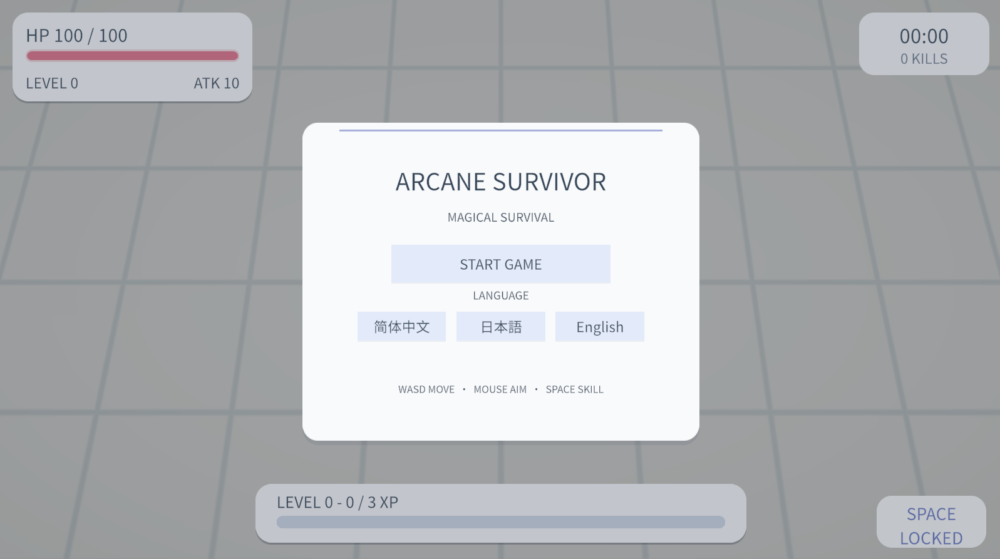
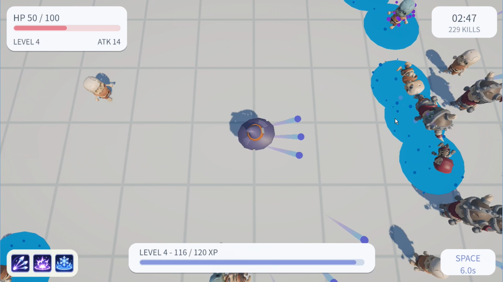
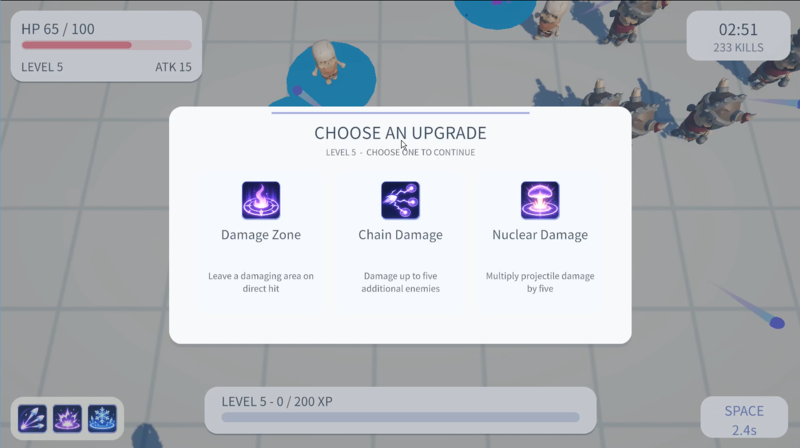
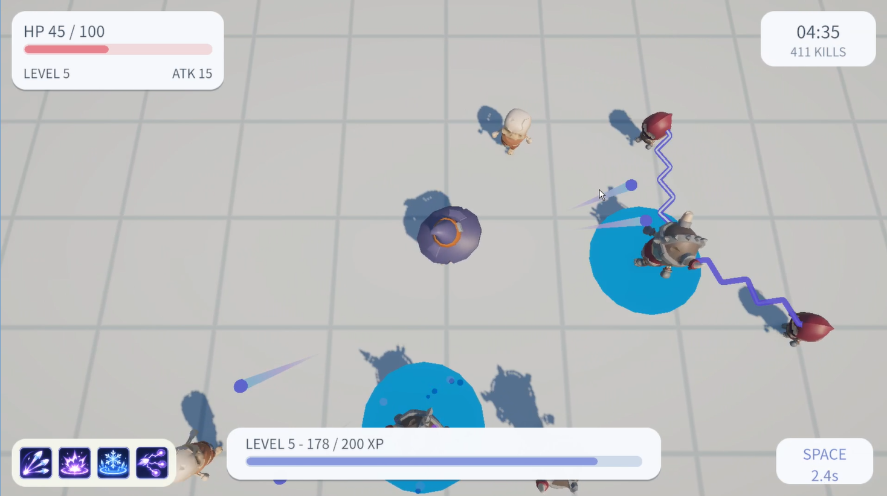
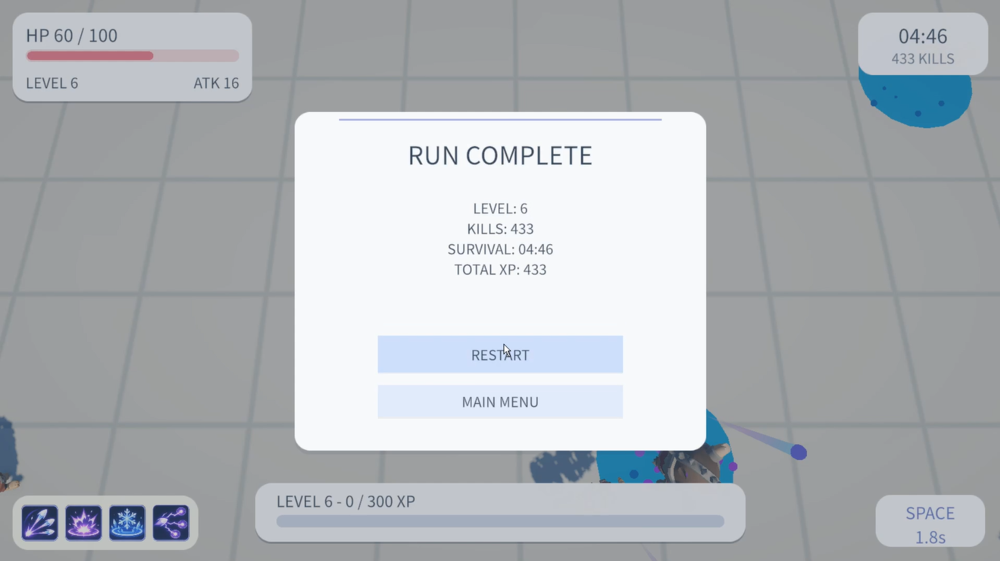

# ArcaneSurvivor

**English** | [简体中文](README.zh-CN.md) | [日本語](README.ja.md)

**ArcaneSurvivor** is a solo-developed, top-down 2.5D action-survival game prototype made with **Unity 6, URP and C#**. Move, aim, and survive waves of enemies while combining magic-projectile upgrades and area effects.

> **Project status:** Playable Windows demo, tested outside the Unity Editor.  
> **Engine:** Unity 6.3 LTS (6000.3.27f2) · Universal Render Pipeline (URP)  
> **Target platform:** Windows x86-64  
> **Developer:** Solo / independent project

## Gameplay

- Move with **WASD** and aim independently using the **mouse**. Normal magic attacks fire automatically.
- Defeat **Normal**, **Fast**, and **Tank** enemies to earn experience.
- Select one of three upgrades at levels **1, 2, 4 and 5**.
- Unlock the radial magic active skill at **level 3**; cast it with **Space**.
- Reach **level 6** to enter the Victory flow, then finish or continue in **Endless** mode.
- Switch the interface among **Chinese, English and Japanese**.

### Upgrade overview

| Level | Available upgrade examples |
| --- | --- |
| 1 | Multishot, Split, Burst Fire |
| 2 | Larger Projectile, Impact Explosion, Pierce |
| 3 | Radial active skill (unlocked automatically) |
| 4 | Double Fire Rate, Area Freeze, Area Slow |
| 5 | Damage Zone, Chain Damage, Nuclear Damage |

The player chooses one upgrade at each selection level. **Only direct projectile hits trigger on-hit effects**. Damage from explosions, chain attacks and damage zones does not recursively trigger them.

## Featured combat effects

| Effect | Behavior |
| --- | --- |
| **Impact Explosion** | Purple particle burst with secondary area damage |
| **Area Freeze** | Ice-blue disk and continuous particles; during its 0.8 s lifetime, newly entering enemies can also be frozen, once per field |
| **Area Slow** | A brief purple pulse marks a one-time slow applied on hit; **not** a persistent slow field |
| **Damage Zone** | Red-pink boundary and glowing ground cracks; periodic damage over 3 s |
| **Chain Damage** | Blue-violet double-layer lightning to up to five additional targets |
| **Nuclear Damage** | High-energy yellow-green projectile and hit feedback, with its own sound effects; ×5 projectile damage without increasing its collision radius |

## Technical highlights

- **Snapshot-based attacks:** `AutoAttackController` prepares per-shot upgrade data before spawning projectiles.
- **Projectile collision and hit processing:** `MagicProjectile`, `ProjectileSpawner` and `HitProcessor` separate movement, hit validation and effect dispatch.
- **Safe secondary-damage rules:** secondary effects do not create recursive chain/explosion events.
- **Timed enemy status effects:** `EnemyStatus` handles freeze and slow priority independently from area VFX.
- **Persistent effects:** `DamageArea` applies periodic damage, while dedicated VFX components draw field indicators, cracks and lightning.
- **Game feel and presentation:** three-language UI, HUD, state-driven menus, sound feedback, Victory and Endless flows.

## Controls

| Input | Action |
| --- | --- |
| **WASD** | Move |
| **Mouse** | Aim |
| **Automatic** | Standard projectile attack |
| **Space** | Radial active skill (after unlocking it) |
| **Esc** | Pause / resume |

## Download and run

The Windows build has been **tested locally**, but a public release link has **not been published yet**.

When a build is attached to GitHub **Releases**, download its ZIP, extract **all files** into the same directory, and run `ArcaneSurvivor.exe`. Do not run or distribute the `.exe` alone without its `_Data` folder and other Unity runtime files.

### Open the source project in Unity

1. Install the matching **Unity 6.3 LTS** editor version (check `ProjectSettings/ProjectVersion.txt`).
2. Open the repository's root folder in Unity Hub.
3. Open the **MainGame** scene under `Assets/Scenes/` (confirm the path against your project).
4. Press Play, or select **File → Build Profiles → Windows** to create a Windows build.

## Repository structure

```text
ArcaneSurvivor/
├── Assets/               # Scripts, scenes, prefabs, art, UI, audio, .meta files
├── Packages/             # Unity package manifest and lockfile
├── ProjectSettings/      # Unity project settings
├── docs/media/           # Seven captured gameplay screenshots
├── README.md             # English
├── README.zh-CN.md       # 简体中文
├── README.ja.md          # 日本語
├── PORTFOLIO_CHECKLIST.md
└── .gitignore
```

Generated folders such as `Library/`, `Temp/`, `Logs/`, and Windows build binaries are excluded from the source repository.

## Screenshots and demonstration

## Screenshots

### Main menu



### Gameplay and upgrade system

| Combat and ice-blue freeze areas | Three-choice upgrade selection |
| --- | --- |
|  |  |

### Chain lightning and run results

| Chain Damage in combat | Run Complete screen |
| --- | --- |
|  |  |

The screenshots are captured from the playable Windows build. A short gameplay showcase video is planned; a link will be added when it is ready.

## Third-party assets and credits

This project uses external resources, including **KayKit skeleton character assets** and certain audio/font resources. **Do not publish their source files without verifying redistribution permissions.** Add the exact asset names, authors, source URLs, license terms and required notices before making the source repository public. A playable build and public source distribution can have different licensing conditions.

## About the project

This is a **solo gameplay-programming prototype** created to demonstrate Unity/C# combat systems, projectile and status-effect interactions, UI localization, and delivery of a playable Windows build.

*Portfolio documentation in progress. Asset-license verification, a gameplay video and a Release download link remain before the public launch.*
