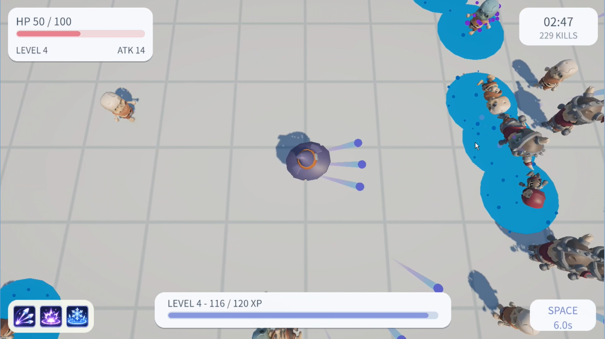
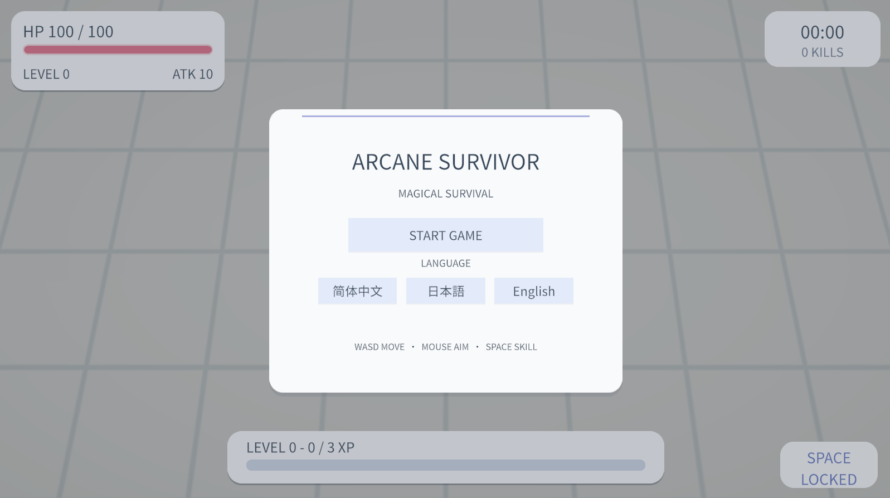
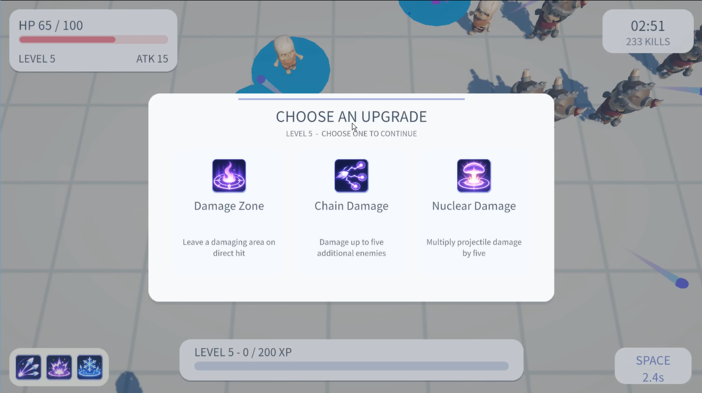
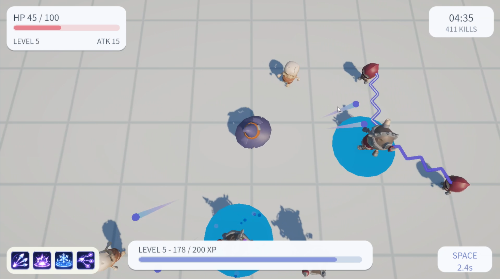
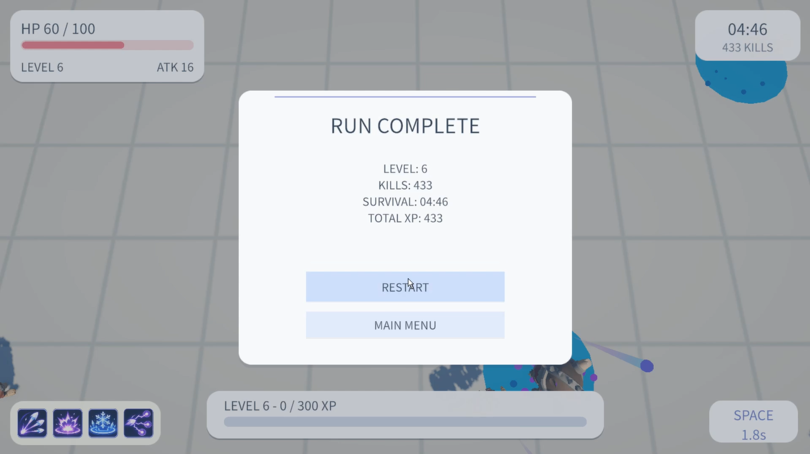

# ArcaneSurvivor

[English](README.md) | **简体中文** | [日本語](README.ja.md)

**ArcaneSurvivor** 是一款个人独立开发的 **2.5D 俯视角动作生存游戏 Demo**，使用 **Unity 6、URP 和 C#** 制作。玩家通过移动与瞄准躲避不断出现的敌人，并组合不同的魔法弹强化、范围控制和持续伤害效果。

> **当前状态：** Windows 可试玩 Demo，已在 Unity 编辑器外独立运行并通过测试。  
> **开发环境：** Unity 6.3 LTS（6000.3.27f2）· Universal Render Pipeline（URP）  
> **目标平台：** Windows x86-64  
> **开发形式：** 个人独立开发

## 游戏玩法

- 使用 **WASD** 移动，通过**鼠标**独立瞄准，普通魔法弹会自动发射。
- 击败 **普通（Normal）**、**快速（Fast）** 和**重型（Tank）** 敌人获得经验值。
- 在 **Lv.1、Lv.2、Lv.4、Lv.5** 从三个选项中选择一个强化。
- **Lv.3** 自动解锁环形主动魔法技能，按 **Space** 使用。
- 升到 **Lv.6** 后进入胜利流程，可选择结束本局或继续进入 **Endless（无尽模式）**。
- 游戏 UI 支持**中文、英语、日语**三种语言。

### 强化系统

| 等级 | 对应强化或技能 |
| --- | --- |
| Lv.1 | 多重射击、分裂、连发 |
| Lv.2 | 弹丸增大、命中爆炸、穿透 |
| Lv.3 | 自动解锁环形主动技能 |
| Lv.4 | 双倍射速、范围冻结、范围减速 |
| Lv.5 | 持续伤害区域、连锁伤害、核能伤害 |

每次强化选择只获得其中一项。**只有魔法弹的有效直接命中能够触发命中效果**；爆炸、连锁和持续区域产生的次级伤害不会递归触发其他命中效果。

## 特色战斗效果

| 效果 | 实际机制与表现 |
| --- | --- |
| **命中爆炸（Impact Explosion）** | 紫色粒子爆炸，造成额外范围伤害 |
| **范围冻结（Area Freeze）** | 冰蓝色实心圆盘和持续粒子；领域存在 0.8 秒，后进入的敌人也可被冻结，每个领域对同一敌人只冻结一次 |
| **范围减速（Area Slow）** | 紫色圆盘短暂闪现，仅在命中瞬间对范围内敌人施加减速，**不是持续减速领域** |
| **持续伤害区域（Damage Zone）** | 红色范围圈与玫红色地面魔法裂纹，持续 3 秒周期性造成伤害 |
| **连锁伤害（Chain Damage）** | 蓝紫色双层闪电，最多追加 5 个目标 |
| **核能伤害（Nuclear Damage）** | 黄绿色高能弹丸、拖尾、命中闪光和专属音效；弹丸伤害 ×5，但不额外扩大碰撞半径 |

## 技术实现要点

- **弹丸数据快照：** `AutoAttackController` 发射前生成本次弹丸的强化数据。
- **命中处理分离：** `MagicProjectile`、`ProjectileSpawner`、`HitProcessor` 分别负责运动与碰撞、生成以及命中效果分发。
- **防止次级效果递归：** 范围爆炸、连锁及持续伤害不会重新触发其他命中效果。
- **敌人状态系统：** `EnemyStatus` 统一管理冻结、减速和优先级，与领域的视觉对象分离。
- **持续范围效果：** `DamageArea` 负责周期性伤害，独立 VFX 脚本负责圆盘、裂纹和连锁闪电。
- **完整游戏流程：** 多语言菜单与 HUD、强化选择、胜利与 Endless 模式、音效反馈。

## 操作方式

| 输入 | 功能 |
| --- | --- |
| **WASD** | 移动 |
| **鼠标** | 瞄准 |
| **自动触发** | 普通魔法弹攻击 |
| **Space** | 环形主动技能（解锁后） |
| **Esc** | 暂停 / 继续 |

## 下载与运行

Windows Demo 已完成独立运行测试，并发布了 **v0.1.0** 版本：**[前往 GitHub Releases 下载](https://github.com/OraSoda/ArcaneSurvivor/releases/tag/v0.1.0)**。

下载 `ArcaneSurvivor_v0.1.0_Windows_x64.zip` 后，需解压**全部文件**，运行 `ArcaneSurvivor.exe`；不能只保留 `.exe` 而删除 `_Data` 等运行文件。

### 从源码启动 Unity 项目

1. 安装与项目匹配的 **Unity 6.3 LTS**（具体版本可查看 `ProjectSettings/ProjectVersion.txt`）。
2. 使用 Unity Hub 打开仓库根目录。
3. 打开 `Assets/Scenes/` 下的 **MainGame** 场景（如实际路径不同，以项目为准）。
4. 在编辑器中点击 Play，或使用 **File → Build Profiles → Windows** 生成 Windows 版本。

## 仓库结构

```text
ArcaneSurvivor/
├── Assets/               # 脚本、场景、Prefab、美术、UI、音频及 .meta 文件
├── Packages/             # Unity 包配置
├── ProjectSettings/      # Unity 项目设置
├── docs/media/           # 七张游戏实机截图
├── README.md             # English
├── README.zh-CN.md       # 简体中文
├── README.ja.md          # 日本語
└── .gitignore
```

`Library/`、`Temp/`、`Logs/` 和 Windows 打包产物等生成文件不进入源码仓库。

## 游戏演示视频

观看约 44 秒的实机演示，了解战斗玩法、升级系统、不同技能组合与通关流程。

[](https://youtu.be/IxcpyEohAj0)

**[在 YouTube 观看](https://youtu.be/IxcpyEohAj0)**

## 游戏截图

### 主菜单与语言切换



### 实机战斗与强化选择

| 实机战斗与冰蓝色冻结领域 | 三选一强化界面 |
| --- | --- |
|  |  |

### 连锁闪电与结算

| 连锁伤害效果 | 本局完成结算 |
| --- | --- |
|  |  |

截图均来自可以独立运行的 Windows Demo。

## 外部素材与致谢

**角色模型与动画：** 本项目使用了 **Kay Lousberg** 制作的 [KayKit Adventurers](https://kaylousberg.itch.io/kaykit-adventurers)、[KayKit Skeletons](https://kaylousberg.itch.io/kaykit-skeletons) 和 [KayKit Character Animations](https://kaylousberg.itch.io/kaykit-character-animations)。上述素材采用 **CC0 1.0** 许可，感谢作者提供这些资源。

**字体：** 游戏使用了 **Noto Sans JP**、**Noto Sans SC**，遵循 **SIL Open Font License 1.1（OFL）**。相应版权声明及完整许可文本见 [`LICENSES/NotoSansJP-OFL.txt`](LICENSES/NotoSansJP-OFL.txt) 和 [`LICENSES/NotoSansSC-OFL.txt`](LICENSES/NotoSansSC-OFL.txt)。TextMesh Pro 自带资源的许可和署名文件继续保留在 `Assets/TextMesh Pro/` 中。

**音效：** 根据项目开发者确认，游戏音效均为 ArcaneSurvivor 专门制作，使用了 AI 辅助，并非取自第三方音效素材包。

素材出处及许可证详情请参阅 [`THIRD_PARTY_NOTICES.md`](THIRD_PARTY_NOTICES.md)。

## 关于本项目

这是一个用于展示 **Unity/C# 游戏程序开发能力**的个人技术 Demo，重点包括自动攻击与魔法弹系统、强化组合、敌人状态管理、范围伤害、UI 本地化及 Windows 独立发布流程。

*第三方素材继续遵循各自的许可证，详情见 [THIRD_PARTY_NOTICES.md](THIRD_PARTY_NOTICES.md)。*
